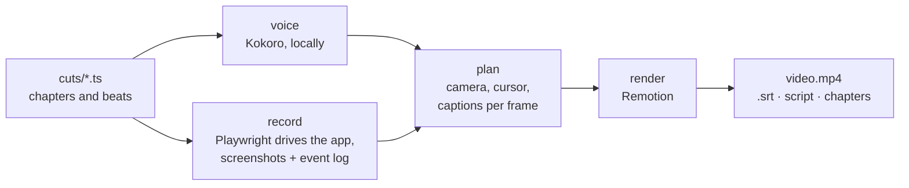

# Showpilot

**Scripted product demo videos that look hand-made.** You write a short script; Showpilot drives your real app in a
browser, films it with a Screen Studio-style camera that glides and zooms onto every click, narrates it with a
natural AI voice that runs on your own computer, and renders a polished 1080p60 video, with subtitles.

Change the UI, run it again, and the whole video is re-shot in one command. No screen recorder, no timeline editing,
no microphone.

- **Real app, real clicks.** Playwright drives the page like a person: eased mouse paths, human typing speed, pauses.
- **A camera that directs itself.** Auto-zoom onto clicks and typing, smooth springs, a glide cursor with click
  ripples, keycaps for shortcuts, callouts, and a macOS-style window on an animated background.
- **A narrator you choose.** [Kokoro](https://huggingface.co/hexgrad/Kokoro-82M) voices, blended and tuned, with
  light markup for pauses, stress and energy. It runs locally: an NVIDIA GPU, Apple Silicon or just the CPU.
- **Or no voice at all.** Silent cuts are paced for reading and come with an `.srt` subtitle file for closed
  captions (VLC, YouTube), plus a timestamped script you can read your own voiceover from.
- **Scenes between the takes.** Kinetic text, badges that pop in as they are named, a closing card, and live app
  footage behind them.
- **Everything else a launch needs.** Chapter titles, a YouTube chapter list, thumbnails, and dubbing narration onto a
  finished render without rendering it again.

## How it works



The stages run one at a time, so recording is never slowed down by anything else on the machine.

## Quick start

Requirements: **Node 20+**, **ffmpeg** on your PATH, and for narration **Python 3.10–3.12**. Windows, macOS and Linux.

```sh
npm install --save-dev showpilot
npx showpilot setup-browser          # the Chromium Playwright drives
npx showpilot init                   # showpilot.config.ts and cuts/tour.ts
npx showpilot check tour             # list chapters and lines, no browser
npx showpilot record tour            # drive the app and record each chapter
npx showpilot render tour            # out/tour/tour.mp4 (+ .srt, script, chapters)
```

For a narrator:

```sh
npx showpilot setup-voice            # Python environment + Kokoro (about 1–3 GB with torch)
npx showpilot voices                 # out/voices/index.html: listen and pick one
npx showpilot voice tour             # speak every line (before recording, so takes are paced to the voice)
```

Try the bundled example from this repository:

```sh
git clone https://github.com/vijaykumargowdakk/showpilot && cd showpilot && npm install
node bin/showpilot.mjs setup-browser
node bin/showpilot.mjs record tour --project examples/hello
node bin/showpilot.mjs render tour --project examples/hello
```

## A script, briefly

```ts
// cuts/tour.ts
import { beat, chapter, cut, scene } from 'showpilot';

export default cut({
  id: 'tour',
  title: 'Taskly: a quick tour',
  chapters: [
    scene('Hello', 'kinetic', [beat({ say: 'Meet *Taskly*. | Your to-dos, | finally under control.' })]),
    chapter('Adding tasks', [
      beat({
        say: 'Type what needs doing, | and press Enter.',
        do: async (s) => {
          await s.type(s.page.getByLabel('New task'), 'Record the launch video');
          await s.press('Enter');
        },
      }),
    ]),
    scene('Thanks', 'cta', [beat({ say: 'Thanks for watching!' })]),
  ],
});
```

Each **beat** is a line of narration and the actions shown while it is spoken; the recorder holds each beat for as
long as its line takes. `|` is a breath, `||` a beat, `*word*` stresses a word, `<up>…</up>` lifts the delivery.

## Documentation

- [Getting started](docs/getting-started.md): install on Windows, macOS or Linux, where files go, uninstalling
- [Writing cuts](docs/writing-cuts.md): chapters, beats, the Studio actions, camera, scenes, b-roll, thumbnails
- [Configuration](docs/configuration.md): `showpilot.config.ts`, brand, app, voice
- [Voice and subtitles](docs/voice.md): picking a narrator, delivery marks, pronunciations, silent cuts, dubbing
- [Troubleshooting](docs/troubleshooting.md)

## Where files go

Heavy, shared files (the browser, the voice model and environment, download caches) live in **`SHOWPILOT_HOME`**
(default `~/.showpilot`; set the variable to put it on another drive). Delete that folder to uninstall them.
A project's recordings and videos go to its own `out/` folder, which `showpilot init` adds to `.gitignore`.

## Licence and credits

Showpilot is free and open source under the [MIT licence](LICENSE), created by
**[Vijay Kumar Gowda K](https://github.com/vijaykumargowdakk)**.

**Your videos are yours.** Showpilot adds no watermark, logo or "made with" line, and you don't need to credit it in
the videos you make, commercial or not.

**Building on the code?** You're welcome to, commercially too. The MIT licence asks one thing: keep the copyright
notice and the licence text with any copy or modified version of Showpilot's code that you share or ship.

Showpilot builds on other projects with their own licences:

- [Remotion](https://www.remotion.dev/license) renders the video. It is free for individuals, non-profits and
  companies of up to 3 people; larger companies need a Remotion company licence.
- [Playwright](https://playwright.dev) (Apache-2.0) drives the browser.
- The voice, installed separately by `showpilot setup-voice`: [Kokoro](https://huggingface.co/hexgrad/Kokoro-82M)
  model and library (Apache-2.0), misaki (Apache-2.0), PyTorch (BSD-3-Clause), and espeak-ng (GPL-3.0, bundled by
  espeakng-loader) for words misaki does not know.

Contributions are welcome: see [CONTRIBUTING.md](CONTRIBUTING.md).
